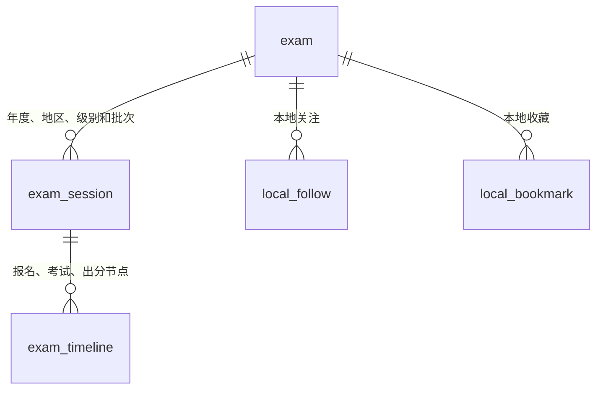

# 考试安排数据模型（SQLite v2）

本次在考试档案之外新增“考试安排”。本地写入接口为 `DatabaseHelper.saveSession`，不是已经上线的服务端接口。

## 数据关系

`exam_session` 字段：

| 字段 | 用途 |
| --- | --- |
| exam_id | 所属考试档案，不以名称作为主键 |
| year | 考试安排年度，未公布或旧资料缺失时允许为空 |
| region | 地区；旧资料为“未注明地区”，不当作全国适用 |
| level / batch | 级别与批次，可为空 |
| status | 待公布、规律参考、已核验、已延期、已取消 |
| source_url | 对应公告来源 |
| published_at / verified_at | 公告发布时间与核验时间，不能混用 |

每个时间节点通过 `session_id` 关联具体安排，并分别保存 `status`、`source_url`、`verified_at` 和原有的日期/预计标志。

## 发布约束

- “已核验”安排必须有年度、可用 HTTP(S) 来源地址、核验时间。
- “已核验”节点还必须有具体日期、节点来源、核验时间，并且不能标记为预计。
- 节点必须属于同一个考试；不可用另一个考试的安排 ID 覆盖数据。
- 保存安排与其节点使用一个事务，失败不得留下半份安排。
- 来源地址的格式通过不代表内容已经被系统核实。本轮尚未开发抓取、审核后台或真实数据发布流程。

## v1 → v2 迁移

采用增量迁移，不重建考试或个人表：

1. 新建 `exam_session`。
2. 原节点增加安排 ID、状态、核验时间。
3. 对有旧节点的考试建立一条“旧版参考”安排。
4. 不推测年度、地区或公告来源；旧安排均为“往年规律参考”。
5. 原始节点日期及文字保留，但不进入“确定的近期日期”列表。
6. 关注、收藏、浏览历史和考试档案保持原 ID。

v1 历史表结构以 `test/fixtures/schema_v1.sql` 为快照，用真实旧库执行升级测试，不使用新表结构伪造旧库。尚未提供数据库降级流程。

## 页面和查询

详情页提供“年份 / 地区 / 批次”组合选择，展示选中安排的节点、状态、来源及核验时间；这不是三个独立筛选器。

`getSessions` 支持按年度和地区查询。`getTimelines` 支持按安排读取。首页近期节点只展示安排和节点均已核验、具备确定日期及来源的记录；参考、延期、取消、待公布的信息不作为确定日期展示。

## 后续工作

- 真实官方数据的采集、草稿、核验和发布后台。
- 服务端版本记录与客户端增量同步；当前本地修改会替换该安排的节点，不保存历史版本。
- 数据变更后的提醒撤销和重新排程。
- 所在地区偏好、年度/地区独立筛选及完整日历。
- 正式数据回填后再完成相应场景的设备验收。
